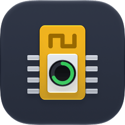
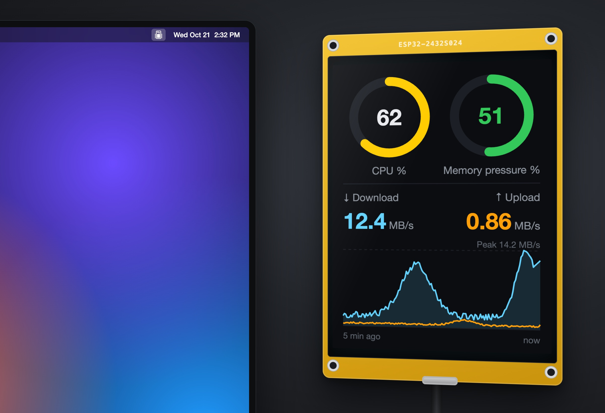
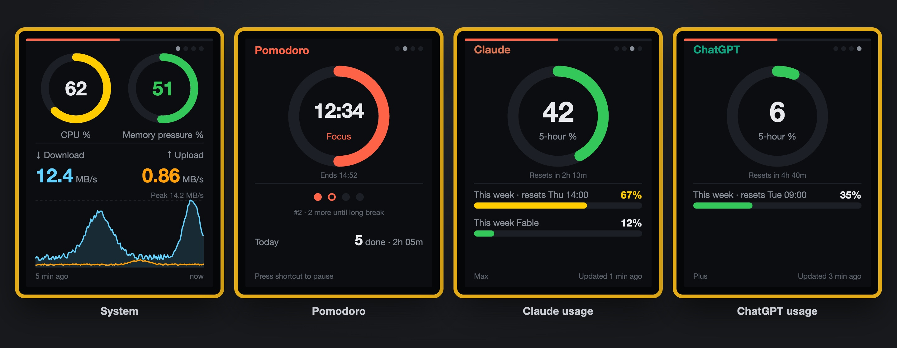
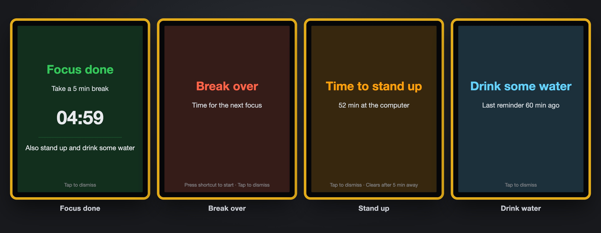
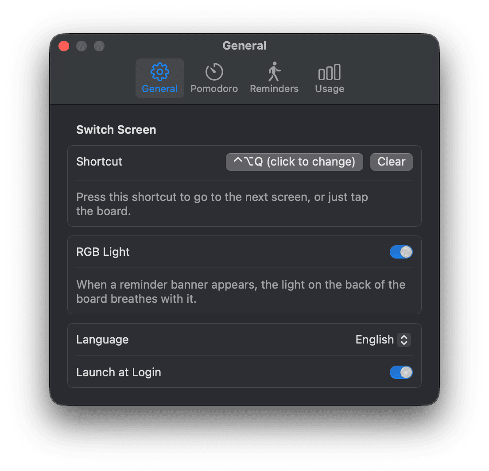
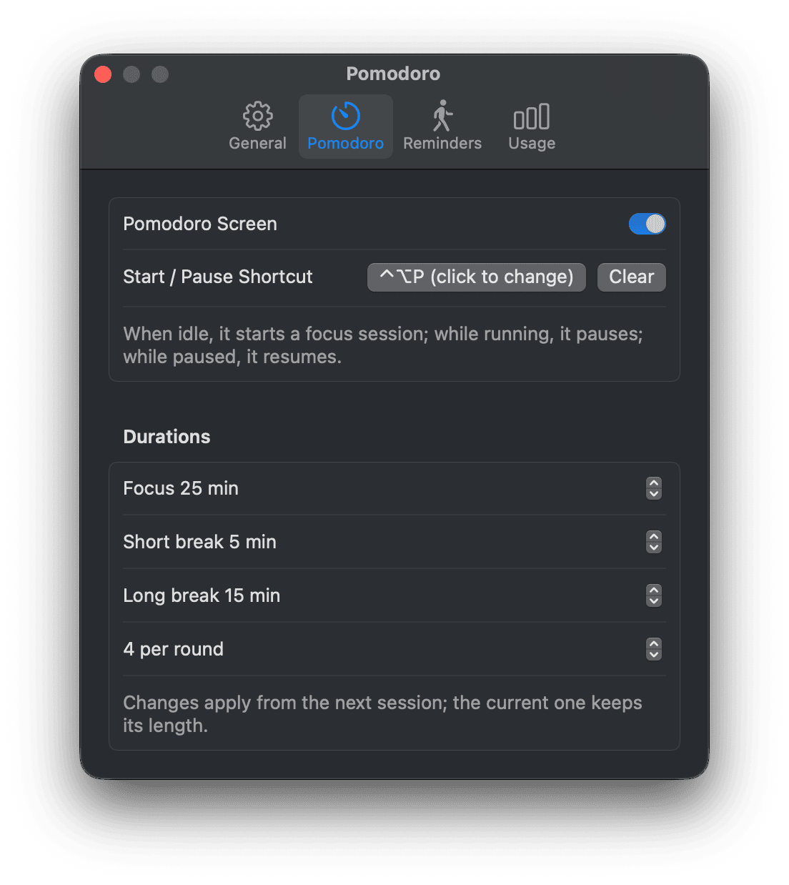
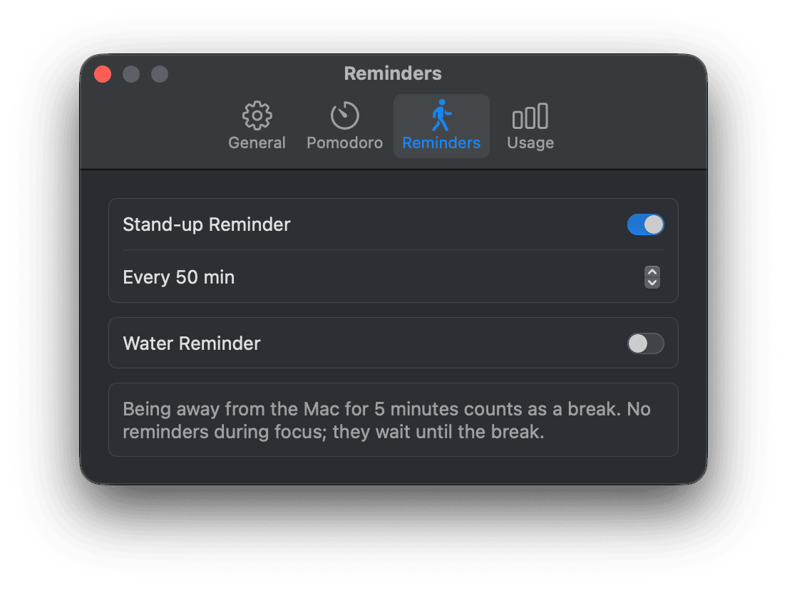
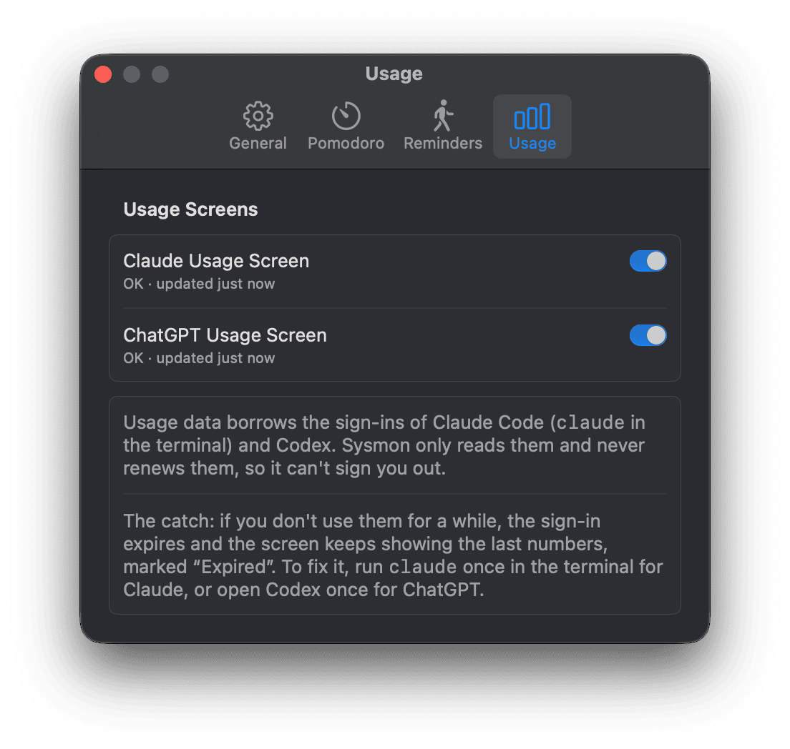

<p align="center"></p>

# Sysmon: uma tela de status do Mac em uma ESP32-2432S024R

[English](../../README.md) | [简体中文](README.zh-CN.md) | [繁體中文](README.zh-TW.md) | [日本語](README.ja.md) | [한국어](README.ko.md) | [Español](README.es.md) | [Français](README.fr.md) | [Deutsch](README.de.md) | **Português (Brasil)** | [Русский](README.ru.md)

Transforme uma ESP32-2432S024R (uma placa com tela ST7789 de 2,4", também conhecida como "Cheap Yellow Display") em uma pequena tela de status ao lado do seu monitor. Num relance, você vê CPU, pressão de memória e velocidade da rede, quanto ainda resta dos limites das suas assinaturas do Claude e do ChatGPT, e um timer pomodoro que lembra você de fazer pausas, levantar e beber água.

O app de barra de menus **Sysmon** coleta os dados do seu Mac a cada 2 segundos e os envia para a placa por serial USB; a placa desenha os anéis e os gráficos. Sem Wi-Fi e sem abrir nenhuma porta no seu Mac.



<sub>As ilustrações são desenhadas a partir do layout e das cores reais do firmware; os dados são inventados.</sub>

> **Nota sobre idiomas:** o app para Mac vem em 10 idiomas. A placa em si, por enquanto, mostra apenas texto em chinês; as imagens deste README mostram uma versão em inglês das mesmas telas.

## Telas

Retrato 240×320, fundo escuro. Quatro telas: Sistema, Pomodoro, uso do Claude e uso do ChatGPT. Um aviso de lembrete pode cobrir qualquer uma delas.



### Sistema

- **Em cima:** anéis de CPU e de pressão de memória. A CPU fica amarela a partir de 50% e vermelha a partir de 80%. O anel de memória segue o nível de pressão de memória do macOS (normal / aviso / crítico), igual ao Monitor de Atividade.
- **Embaixo:** velocidade atual de download e upload, mais um gráfico em duas cores dos últimos 5 minutos. O gráfico é escalado pelo pico dos 5 minutos.

### Pomodoro

- Um anel grande mostra quanto resta da sessão atual, com o tempo restante, a fase e a hora em que termina. Foco é vermelho-tomate, pausa curta é verde, pausa longa é azul; pausado ou não iniciado é cinza.
- Abaixo: bolinhas da rodada atual (4 sessões de foco por padrão), por exemplo "#2 · 2 more until long break" (faltam 2 para a pausa longa), e o total do dia, por exemplo "5 done · 2h 05m" (5 concluídas · 2 h 05 min).
- Padrões: 25 min de foco, 5 min de pausa curta, 15 min de pausa longa a cada 4 focos. Tudo ajustável; as mudanças valem a partir da próxima sessão.
- Só o foco precisa ser iniciado manualmente: um foco concluído passa direto para uma pausa, e uma pausa concluída espera por você.
- Inicie, pause e retome com um atalho global ou pelo menu; o menu também tem Pular e Reiniciar rodada. Pular um foco o abandona, e ele não é contado.
- O timer roda em tempo real, então continua enquanto você está fora, a tela está bloqueada ou o Mac está em repouso. O total do dia zera à meia-noite e sobrevive a reinicializações.
- Enquanto você está em foco, as outras telas mostram uma linha de progresso fina de 3 px vermelho-tomate bem no topo (cinza enquanto pausado).

### Uso do Claude e do ChatGPT

- Um anel grande para o limite de 5 horas com o tempo até ele reiniciar, e barras para o limite semanal ("This week · resets Thu 14:00", ou seja, esta semana · reinicia qui 14:00). O Claude também mostra os limites semanais por modelo quando a API os informa.
- Os mesmos limiares de cor da CPU. O rodapé mostra o plano (Max, Plus…) e quão recentes são os dados.
- Dados desatualizados sempre são marcados: "Expirado" quando o login expirou, "Falha na leitura" quando uma requisição falhou e "--" quando uma janela já reiniciou.

### Avisos de lembrete



Em qualquer tela em que você esteja, um aviso ocupa a tela inteira e a luz RGB na parte de trás da placa pulsa na mesma cor (você pode desligar a luz). Toque na placa ou pressione o atalho de trocar de tela para dispensá-lo.

| Aviso | Quando | Cor | Some sozinho |
|---|---|---|---|
| Foco concluído (*Focus done*) | Uma sessão de foco termina e a pausa começa; mostra a contagem regressiva da pausa e os lembretes retidos durante o foco | verde | quando a pausa termina |
| Fim da pausa (*Break over*) | A pausa termina | vermelho | quando você inicia o próximo foco |
| Levante-se (*Stand up*) | 50 minutos de uso real do computador | laranja | após 5 minutos longe |
| Beba água (*Drink water*) | 60 minutos de uso do computador | azul | não, toque para dispensar |

- "Uso do computador" significa atividade de teclado ou mouse. Tempo ocioso e tela bloqueada ou em repouso contam como tempo longe: 5 minutos longe zeram o timer de levantar, e 30 minutos zeram o timer de água.
- Sem avisos durante o foco (inclusive pausado): eles ficam retidos e são incluídos no aviso "Foco concluído".
- Um aviso por vez, na ordem da tabela.

### Trocar de tela e desligar

- Ordem: Sistema → Pomodoro → Claude → ChatGPT. Toque em qualquer lugar da placa ou use o atalho global. Enquanto um aviso está na tela, a mesma ação o dispensa.
- As telas desativadas nos Ajustes são puladas. Os pontos de página no canto superior direito mostram onde você está.
- A tela e a luz apagam assim que o monitor entra em repouso, a tela é bloqueada, você troca de usuário ou o Mac entra em repouso, e voltam automaticamente. Cerca de 10 segundos depois que o Sysmon é encerrado ou o cabo é desconectado, a tela se apaga.

## O app de barra de menus

- O ícone é um módulo ESP32; ele ganha uma barra diagonal enquanto nenhuma placa estiver conectada.
- O menu tem o status da conexão, as ações do pomodoro que fazem sentido no momento, Ajustes, Sobre o Sysmon e Sair.
- Os Ajustes têm quatro abas:
  - **Geral:** o atalho de trocar de tela, a luz RGB, o idioma do app ("Igual ao sistema" ou um dos 10 idiomas) e "Abrir ao iniciar sessão".
  - **Pomodoro:** a tela do pomodoro, o atalho de iniciar/pausar, as durações e as sessões por rodada.
  - **Lembretes:** lembretes de levantar e de beber água e seus intervalos.
  - **Uso:** as telas de uso do Claude e do ChatGPT com seu status e de onde vêm os dados.
- Os atalhos globais usam hot keys do Carbon, então não é preciso permissão de Acessibilidade. Detectar se você está no computador lê o tempo ocioso do sistema, o que também não exige permissão.
- Ele encontra a placa pelo ID de fabricante USB da WCH (CH340) e reconecta depois de reconectar o cabo. Abrir ou fechar a porta nunca reinicia a placa.
- O uso de CPU fica próximo de 0%.

<p align="center">
  
  
</p>
<p align="center">
  
  
</p>

### De onde vêm os dados de uso

O Sysmon aproveita os logins que já existem no seu Mac, somente leitura:

- **Claude:** as credenciais do Claude Code no keychain de login (item `Claude Code-credentials`, lidas por meio de `/usr/bin/security`, então sem pedido de permissão), enviadas ao endpoint de uso da Anthropic.
- **ChatGPT:** o `~/.codex/auth.json` do Codex, enviado ao endpoint de uso do ChatGPT.

O Sysmon nunca renova esses logins e nunca grava no keychain nem no `auth.json`, então não pode desconectar você. A desvantagem: se você ficar um tempo sem usar o Claude Code ou o Codex, o login expira e a tela mantém os últimos números, marcados como "Expirado". Para resolver, rode `claude` uma vez no Terminal ou abra o Codex uma vez; os números novos aparecem em até 2 minutos. O uso é consultado a cada 2 minutos, e não enquanto a tela está apagada.

Nenhum dos dois endpoints é documentado e qualquer um pode mudar. Se um deles não puder ser interpretado, apenas aquela tela mostra "Falha na leitura".

## Requisitos

| Item | Requisito |
|---|---|
| Placa | ESP32-2432S024R (ESP32-D0WD-V3, 4 MB de flash, ST7789 240×320, serial CH340) |
| Mac | macOS 14 ou posterior |
| Toolchain do firmware | [PlatformIO](https://platformio.org/) |
| Toolchain do Mac | Xcode Command Line Tools (Swift 6) |

## Início rápido

```bash
git clone git@github.com:pokoblin/esp32-2432S024r-macos.git
cd esp32-2432S024r-macos
```

### 1. Gravar o firmware

```bash
cd sysmon/firmware
pio run -e esp32dev -t upload
```

O `platformio.ini` usa `/dev/cu.usbserial-114110`; troque pela sua porta (`ls /dev/cu.usbserial-*`). Encerre o Sysmon antes de gravar, ou a porta estará ocupada.

> Por um hub USB, esta placa falha ao gravar a 921600 e 460800, então `upload_speed` está fixo em 115200.

### 2. Instalar o app de barra de menus

```bash
cd sysmon/macos
bash scripts/bundle.sh
open ~/Applications/Sysmon.app
```

O `bundle.sh` compila uma versão release, cria o `Sysmon.app`, assina com assinatura ad hoc e instala em `~/Applications`. Ative "Abrir ao iniciar sessão" nos Ajustes se quiser.

## Desenvolvimento

Rodar os testes:

```bash
cd sysmon/firmware && pio test -e native
cd sysmon/macos && swift test
```

Controlar a placa sem o Sysmon (precisa do pyserial; o Python do PlatformIO já o inclui):

```bash
python sysmon/tools/fake_feed.py /dev/cu.usbserial-114110                    # sys / pomo / cl / gpt com --page
python sysmon/tools/fake_feed.py /dev/cu.usbserial-114110 --cycle            # alternar as telas automaticamente
python sysmon/tools/fake_feed.py /dev/cu.usbserial-114110 --page pomo --phase paused
python sysmon/tools/fake_feed.py /dev/cu.usbserial-114110 --banner done      # done / brk / sit / water
python sysmon/tools/fake_feed.py /dev/cu.usbserial-114110 --off
```

Os títulos dos avisos usam uma fonte minúscula que contém apenas os caracteres de que precisam (o firmware já usa mais de 90% da flash). Depois de mudar os títulos em `lib/sysmon_core/banner_titles.h`, gere-a de novo; a fonte é a Source Han Sans CN Bold (SIL Open Font License 1.1) e precisa estar instalada localmente:

```bash
swift sysmon/tools/make_banner_font.swift ~/Library/Fonts/SourceHanSansCN-Bold.otf 24
```

As imagens deste README são geradas por `docs/images/make_preview.py` e `docs/images/make_screens.py`; os comandos estão no cabeçalho de cada script.

### Protocolo serial

115200 8N1, texto simples, um registro por linha:

```
S cpu=37 mem=51 lvl=1 rx=13002342 tx=880640
OFF
```

| Campo | Significado |
|---|---|
| `cpu` | uso da CPU, 0–100 |
| `mem` | porcentagem de pressão de memória, 0–100 |
| `lvl` | nível de pressão de memória: 1 normal, 2 aviso, 4 crítico |
| `rx` / `tx` | velocidade de download / upload, bytes por segundo |
| `OFF` | desliga a tela até a próxima linha `S` |

O firmware ignora linhas e campos desconhecidos. Páginas, uso, pomodoro e avisos usam as linhas `P`, `U`, `T` e `B`, e a placa envia `TAP` quando é tocada: veja os comentários de cabeçalho de `usage_protocol.h`, `timer_protocol.h` e `Protocol.swift`.

## Estrutura do repositório

```
sysmon/
  firmware/            ESP32 firmware (PlatformIO + Arduino + LovyanGFX)
    lib/sysmon_core/   pure logic: protocol parsing, screen-off state, chart history, copy, tap debounce, colors, breathing curve
    src/               display config, drawing, RGB light, generated banner font, main loop
    test/              unit tests that run on the computer
  macos/               menu bar app (SwiftPM)
    Sources/SysmonCore/  CPU/memory/network sampling, serial, device discovery, usage credentials and parsing,
                         page order, pomodoro and reminder rules, localization
    Sources/Sysmon/      SwiftUI menu bar UI, Settings, About, global shortcuts
    scripts/bundle.sh    build and install the .app
    scripts/make_icon.sh     compiles the app icon from AppIcon.icon (Icon Composer)
  tools/fake_feed.py   fake data for the board, no Mac app needed
  tools/make_banner_font.swift  generates the banner title font
hw_probe/              hardware probe firmware: display driver, touch chip and pins
touch_diag/            raw XPT2046 touch diagnostics
touch_test/            touch calibration and drawing test; board.h is the verified display config
docs/images/           README pictures and their generators
docs/readme/           translated READMEs
```

## Notas de hardware

- O controlador do display é um **ST7789**, não um ILI9341. Com `Panel_ILI9341` a imagem sai transposta e espelhada.
- Configurações do LovyanGFX: `rgb_order=false` (true troca vermelho e azul), `invert=false`, rotação 0.
- Luz de fundo no GPIO27, ativa em nível alto. O MISO do display não está conectado, então seu ID não pode ser lido.
- O LED RGB na parte de trás é de ânodo comum, ativo em nível baixo: GPIO4 vermelho, GPIO16 azul, GPIO17 verde (azul e verde estão ao contrário do que a maioria das anotações sobre a CYD diz).
- O CH340 controla EN e GPIO0 por DTR/RTS. O Sysmon desativa os dois logo depois de abrir a porta e desliga o `HUPCL`, então abrir ou fechar a porta nunca reinicia a placa.
